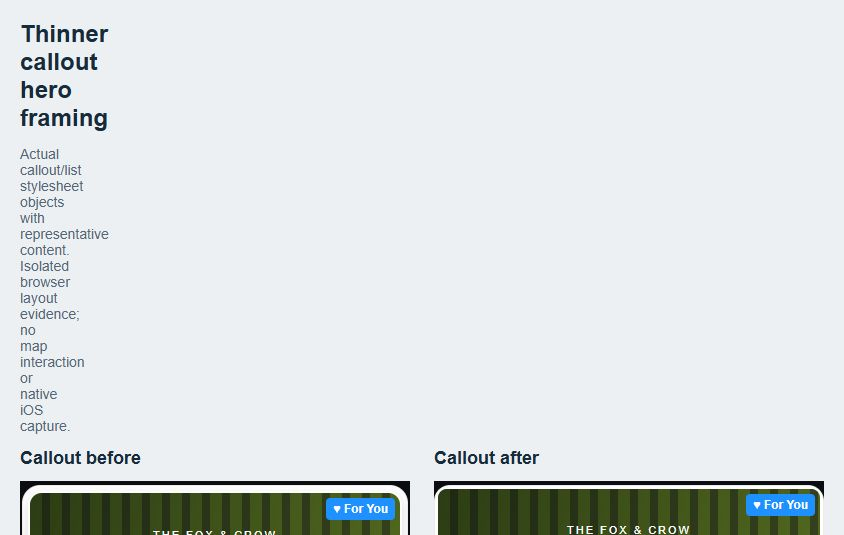

# Callout event/special hero framing

Craig accepted the list-spacing update on his phone, then requested the same thin hero framing for event/special cards inside callouts. He explicitly said the ads already look good. Preserve those ads and the accepted list layout.

Only EventCallout.tsx styles change: the shared SpecialCard loses its 2pt horizontal margin, changes radius18 to16, removes the hero container's 5pt padding, and uses the list's radius12/3pt solid-white photo border. The photo now starts4pt from the card edge (1pt outer border plus3pt photo border), matching the list reference, instead of8pt. Outer card aligns with the existing callout ad width. Hero height stays200pt; content/timing/category/action styles are unchanged. Shared Events/Specials markup, all non-style callout code, ad component, gates, paging, gestures, overlay handlers, safe areas and dock behavior remain unchanged.

Checkpoint branch codex/checkpoint-callout-hero-spacing-20261019 retains clean pre-change HEAD7b4bc9e. Continue on owned carousel-boundaries checkout / codex/feed-optimization-20261018. Live iOS Preview base d501108677b39b2308436b940921ff9bb36a70bf / OTA01a15401 was read live and is retained.

The isolated browser render uses exact stylesheet objects extracted from current/baseline callout and list sources, with representative content and simulated icons/ForYou badge. Hero engagement positioning, border, padding, card and content geometry come from the actual styles. It is an equivalent geometry artifact, not a full component mount, native iOS screenshot, real creative or map test. Independently reviewed borders, alignment, overlays, hierarchy and action spacing. Seven measured cases cover before/after Events/Specials,300pt and500pt callouts and accepted list reference; all have zero horizontal overflow. At390pt the new hero frame is388pt wide, matching the list reference; the previous hero frame was374pt.

Validation: non-style callout source equality after removing its styles argument and normalizing line endings; hero radius/border/color equal list; hero height unchanged. TypeScript passes. First typecheck picked up an ignored previous-task QA copy with intentionally mocked relative imports; that isolated fixture now has ts-nocheck, without changing application TypeScript configuration or runtime. Final check passes. Lint0errors/215existing warnings. Three suites/11tests pass for callout interaction safety, modal tab touch layer and original compact-ad mount/cancellation/identity guards. No new margin-only tests added.

No map/device/emulator interaction, new native build, backend mutation, Android/Production publication or ad formatting change. Production stays held. Native iOS appearance/adoption await phone confirmation after Preview publication. Raw renderer, checks and EAS readbacks: ignored artifacts/callout-hero-spacing-20261019/.
