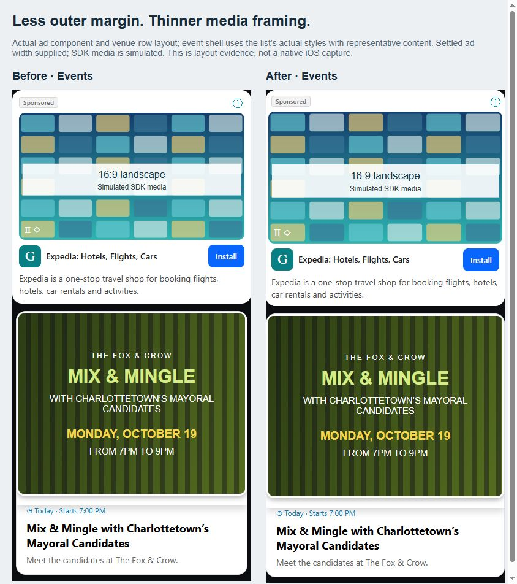

# Wider list cards and thinner ad media framing

Craig requested less black space beside event cards and less white side padding beside ad media, matching the event hero's thin frame. Applies to both Events and Specials.

- Single event/special cards and grouped venue rows now use zero horizontal margin, matching the existing ad outer edges instead of retaining 6pt per side. Group pager initial width accounts for the wider viewport; measured paging/selection behavior is unchanged.
- Shared ad card media inset is 4pt per side (3pt padding plus 1pt card border), replacing 9pt. Events' redundant 2pt ad-wrapper border is removed so Events and Specials have identical media framing.
- Text, icon, disclosure and CTA keep their existing 9pt outer-side inset through inner margins. Portrait details preserve their original right inset, the 12pt media/detail gap and right-column Sponsored placement. Vertical spacing and the inset-free SDK view are retained.
- Media dimensions use the same exported side-padding constant as the card. Portrait/landscape proportions, containment, 420pt cap, existing narrow-phone cutoff (306pt outer card width) and enlarged-text fallback are preserved. Callout ads inherit the shared padding change; their native mount gate is untouched.

## Rendered evidence

The browser fixtures render the actual shared ad card and actual VenueEventRow. Representative event content uses the exact list stylesheet objects extracted by TypeScript AST. Settled card width is supplied to the component state; SDK media/overlay, avatar, favorite and count animation are simulated. These are trustworthy layout comparisons, not native iOS screenshots or playback validation. No GathR map/device/emulator operation occurred.

Independently reviewed before/after Events, light/dark portrait, grouped Events/Specials for edge alignment, spacing, disclosure, readable text and buttons. At 390pt, both ad and event/group outer widths are 390pt, media inset is 4pt and no horizontal overflow appears. All eleven fixture measurements, including 300pt narrow phone, 160% ad text and 800pt tablet, show zero horizontal overflow. Narrow and enlarged-text portrait containment intentionally leaves additional space around narrower proportional media.

## Validation

- TypeScript passes; lint exits zero, 0 errors / 215 existing warnings.
- Five focused suites / 45 tests pass across the initial run plus the corrected callout width-expectation rerun. Initial run was 44 passing / 1 obsolete callout width assertion failing; rerun of that complete suite passes 8/8. Existing size expectations were updated; no behavior-only tests added for margins.
- Coverage retains SDK instance ownership/asset registration, inset-free Fabric root, per-ad iOS mount delay/cancellation, disabled-media fallback, proportional responsive layouts, grouped paging and deferred saved-card ranking.
- Live Preview base is 65ec56ad11e80ec8a0116a559f037fafc5168ac2 / OTA01a153f1. Preserve the accepted logo outline and all earlier ad/feed changes. Production stays held.

Raw harness, fixtures, logs, live readbacks and export verification: ignored artifacts/list-card-spacing-20261019/.
