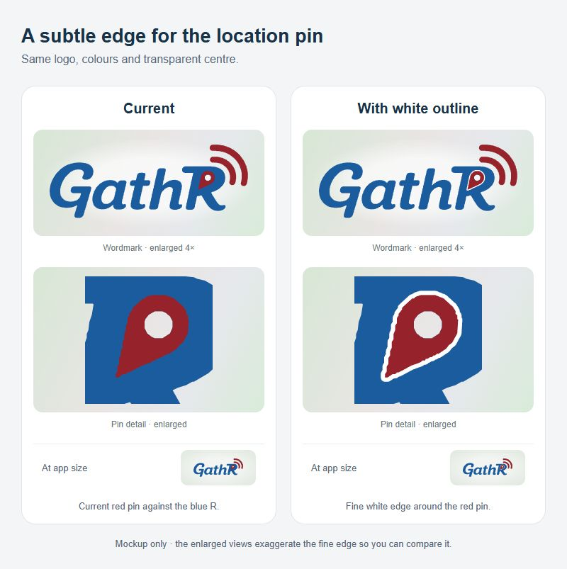

# Map wordmark pin outline

Craig approved the before/after mockup and explicitly requested iOS Preview publication on October 19.

The map wordmark adds a white exterior separator behind the exact existing red pin contour. At 70pt wordmark width the exposed edge is approximately 0.34pt. The red fill covers the inner half of the 10-unit stroke. Blue letter geometry, red pin/counter/arcs geometry, transparent circular centre, 70x26 dimensions and existing fading backdrop remain unchanged. Radio arcs have no new outline.

The comparison renders the actual before/after component SVG paths on an illustrative background, at enlarged and app dimensions. It was independently reviewed for pin shape, clear centre, spacing and subtlety, then approved by Craig. This is isolated browser rendering, not native iOS screenshot evidence. No map interaction or device manipulation was performed.

Validation: exact blue-path and combined red-contour equality against the accepted baseline; TypeScript and lint; guarded iOS auth/social/Mapbox/export checks. Raw logs, mockup renderer and readbacks are under ignored artifacts/map-pin-halo-20261019/.

This change is additive to accepted callout/feed ad layouts and deferred saved-card ranking. No new raster asset, native/config/runtime/dependency or backend change is needed. Production remains held; only iOS Preview is authorized.
