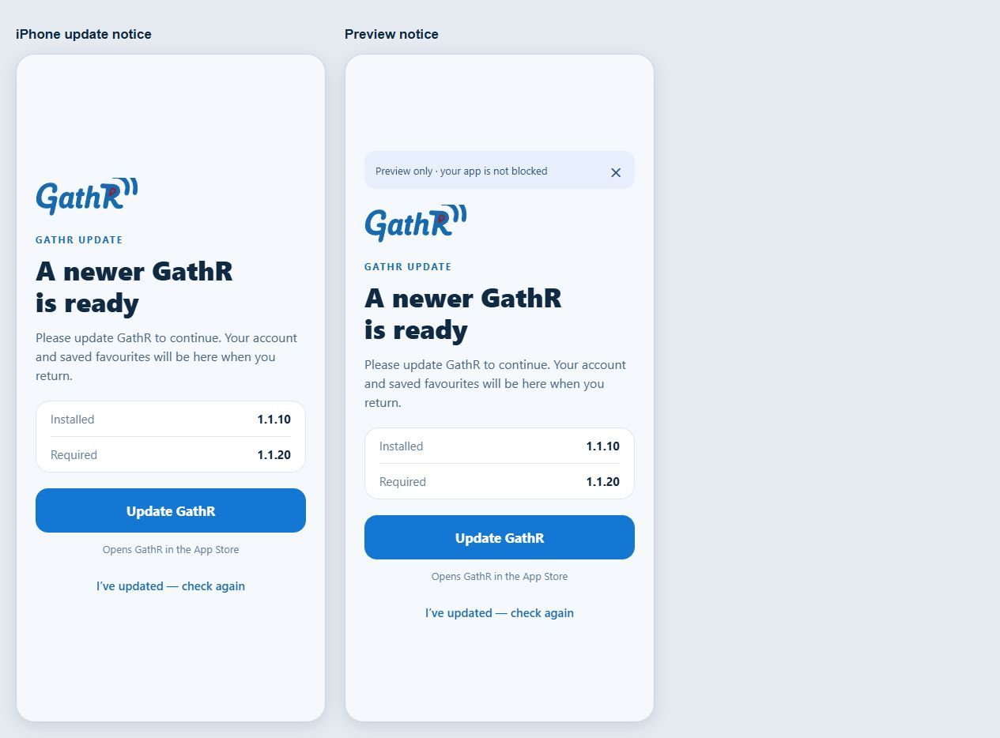
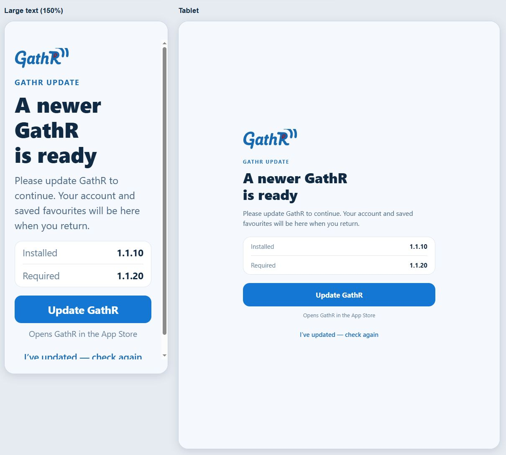

# Minimum version gate implementation and validation

Owned checkout: carousel-boundaries / codex/feed-optimization-20261018, starting clean HEAD597b850. Checkpoint branch codex/checkpoint-minimum-version-20261019 retains it. Current live iOS Preview source c2bfb2b555f4a8f1c26f0ec1315370b107c79726, update01a1540b, group39ed890a-9752-4ad7-8277-ce8f544f1477, runtime1.1.10 was read through EAS list/view and is retained in ancestry. Craig accepted the callout hero framing: “That did it, thanks.” Earlier accepted list/ad/save/logo work remains unchanged.

Added a root-level native modal gate, strict pure policy evaluation, bounded anonymous policy fetching and launch/foreground/retry lifecycle. The native installed version is authoritative. Only Production mobile can enforce; Preview gets a footer-accessible sample of the same UI. Both platforms start disabled. Existing navigator/providers stay mounted. No native/config/runtime/dependency changes or map operation. [Operational contract and activation limits](../../MINIMUM_APP_VERSION.md).

Four focused suites / 53 tests pass: numeric comparisons and malformed versions; independent platforms and two explicit activation flags; old/unknown OS fail-open; Production/channel eligibility; disabled initial policy; missing/bad/offline/oversized responses; whole-request deadline including a hanging body; external cancellation; native version versus higher OTA runtime; no Preview requests; foreground throttle, immediate blocked return, single-flight manual retry, offline release, unmount cleanup; fixed store destinations, store failure recovery, non-dismissible real modal, disabled retry while checking and closable Preview. Initial test failures were harness issues (namespace mocks copied native-version values; memoized Pressable lookup), corrected without changing working application behavior. TypeScript passes. Lint zero errors / 215 existing warnings.

Rendered the actual UpdateRequiredNotice module and its existing wordmark through React Native Web, with simulated safe-area padding and actual styles. Cases: iPhone required notice, Preview banner, narrow Android with store error, rechecking, 150% text and tablet. Independently inspected alignment, hierarchy, spacing, contrast and available actions. Phone/narrow cases have no horizontal overflow; large text scrolls vertically to the remaining action, and tablet content caps at460pt. This is isolated browser component evidence, not a native iOS screenshot, Production enforcement test, successful store upgrade or device adoption. No GathR map was opened or manipulated.

Raw renderer, screenshots, unit/type/lint logs, EAS readbacks and export verification are in ignored artifacts/minimum-version-gate-20261019/. Remote policy hosting initially could not run because Google Cloud requires reauthentication; a user sign-in request is pending. Code fails open until a valid policy exists. No Production activation, Production/Android OTA, new native build, backend deployment or event/user data write is authorized by this task. Preview publication and eventual hosting result will be recorded separately.
